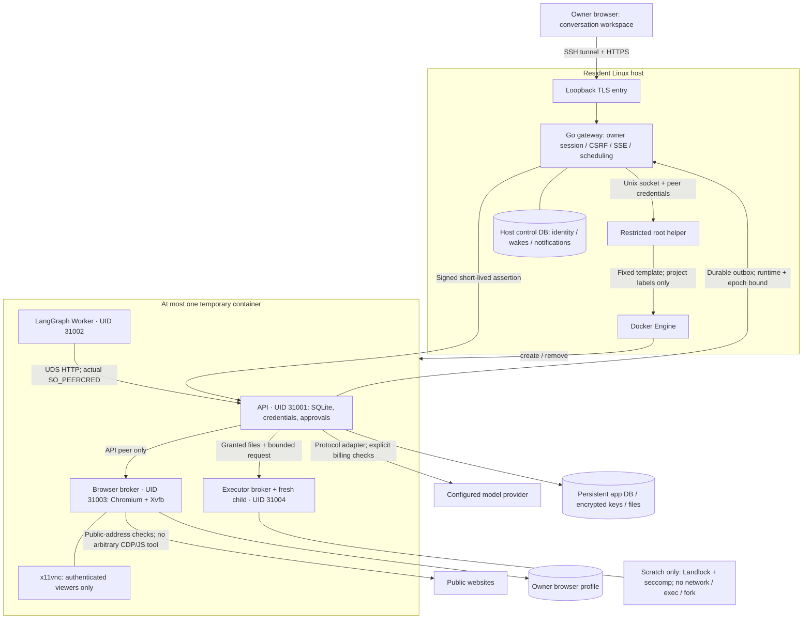
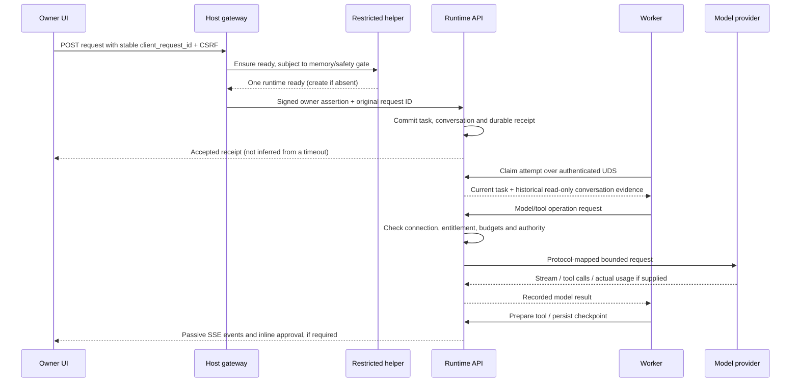
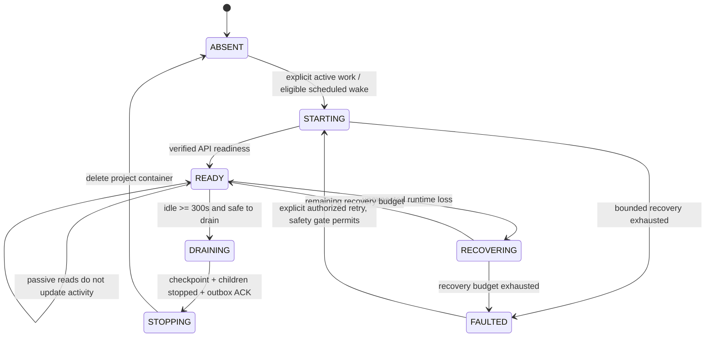

# Architecture

Dream Bot is a single-owner personal agent. A small resident host layer owns identity and runtime lifecycle; one disposable container performs work. Durable state lives outside that container. These diagrams describe implemented boundaries, not a claim that every acceptance scenario has passed.

## Trust and process boundaries

Only the host helper receives access to Docker. The runtime has neither a Docker socket nor unrelated host mounts. Browser control and generated code do not inherit the API's database or model-key access. Unix peer credentials are obtained from the accepted socket rather than trusted from an HTTP header.

## Request and conversation flow

Request IDs are idempotent and bound to content. Execution IDs, tool dispatches, approvals, audit events and provider protocol state remain distinct. A follow-up can read prior successful conversation evidence but does not inherit old approvals or browser observation references. MiniMax reasoning and Responses opaque items stay with their original execution; they are not blindly replayed into another model's context.

## Disposable runtime lifecycle

Human takeover, executable tasks and pending control handoff can prevent safe removal. A memory-protection suspension is durable and ordinary page refresh cannot clear it. Read-only viewing does not block natural idle deletion. Browser-process memory, sockets and live pages disappear when the container is deleted; persistent profile storage is not a memory snapshot.

## Browser ownership

```mermaid
flowchart LR
    CARD[Conversation browser card] --> PANEL[Inline work panel]
    PANEL --> TICKET[Explicit viewer request: expected_task_id]
    TICKET --> AUTH[Owner + session + task + epoch validation]
    AUTH --> WS[Short-lived ticket consumed by authenticated WebSocket]
    WS --> VNC[Start private x11vnc transport]
    VNC --> FRAME[Read-only frames by default]
    FRAME --> TAKE[Explicit takeover: pause Agent and revoke old inputs]
    TAKE --> INPUT[Server validates device/session/task/epoch per input]
    INPUT --> RELEASE[Explicit release: task stays paused until continued]
```

Switching execution revokes old tickets, sockets and input bridges. A follow-up in the same conversation can keep the page. A different conversation gets a new page and closes the old pages, including back/forward history. The owner's profile and cookies remain shared; this is not per-conversation account isolation. Tool status hides another conversation's URL without waking or rebinding its browser. The public owner-authenticated status endpoint remains an owner-global observation.

Creating an unused viewer ticket does not start x11vnc. The last viewer disconnect starts a 30-second retirement timer; Chromium keeps its page until existing browser/runtime lifetime rules close it. Takeover expiry does not grant a new five-minute lifetime.

## Persistence and recovery

| Area | Owner | Lifetime and contents |
| --- | --- | --- |
| `control/` | Host gateway | Owner auth, deployment epoch, schedule/model wakes, notifications |
| `app/` | Runtime API | SQLite WAL, encrypted model credentials, tasks, conversations, checkpoints, approvals, usage |
| `files/` | Runtime API | Explicit uploads and verified generated artifacts; task-scoped grants |
| `browser/` | Browser UID | Owner browser profile and cookies |
| `backups/` | Host backup flow | age-encrypted application archives; protect private recovery identities separately |
| `/scratch` | Temporary runtime | Bounded execution scratch, deleted with runtime |

Backups are consistent application snapshots, not arbitrary host archives. Restore changes authority epoch, invalidates old sessions/approvals, pauses schedules and requires review of unfinished or uncertain work. Do not overwrite a live database with an older copy after new owner activity. Host image/index rollback and data restore are separate operations.

## Resource profile and limitations

The compact configuration uses 1 CPU / 2 GiB / 256 PIDs per runtime and a 1.5 CPU / 2432 MiB project slice, reserving at least 768 MiB conservatively for the host. These are application admission limits, not a guarantee for arbitrary tasks or other host workloads. Build and backup work need their own capacity and maintenance planning.

The native target is Linux amd64 with cgroup v2, AppArmor, Landlock and seccomp. No unrestricted subprocess fallback, warm pool, independent 120-second browser timer, Firecracker or VM memory snapshot is implemented. [Sandbox profile](sandbox-profiles.md) · [Validation boundaries](STATUS.md)
