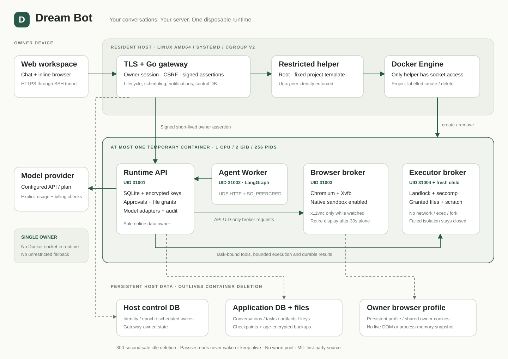

# Dream Bot · 梦 Bot

**وكيل شخصي تستضيفه على خادمك، مع محادثات دائمة وبيئة تنفيذ مؤقتة.**

[English](../../README.md) · [简体中文](README.zh-CN.md) · [繁體中文](README.zh-TW.md) · [日本語](README.ja.md) · [한국어](README.ko.md) · [Español](README.es.md) · [Français](README.fr.md) · [Deutsch](README.de.md) · [Português](README.pt-BR.md) · [Русский](README.ru.md) · [العربية](README.ar.md) · [हिन्दी](README.hi.md)

يحفظ Dream Bot المحادثات والملفات وملف المتصفح على خادمك. تبقى بوابة صغيرة قيد التشغيل، ويُنشأ حاوي Docker واحد كحد أقصى للعمل ثم يُحذف بعد 300 ثانية من الخمول الآمن. يظهر المتصفح والتحكم اليدوي ومعاينة الملفات داخل لوحة المحادثة.

## المزايا

- محادثات وسجلات تنفيذ دائمة، وموافقات صريحة، ومراجعة للنتائج الخارجية غير المؤكدة.
- متصفح Chromium فعلي، ومعالجة ملفات، وذاكرة مؤكدة، وجدولة، ونسخ احتياطية مشفرة.
- واجهات متوافقة مع Chat Completions أو Responses، بما فيها مزودون صينيون قابلون للضبط. تتطلب خطط Token/Coding استخداماً تسمح به شروط المزود؛ توافق البروتوكول لا يثبت حق الاستخدام.
- لا توقظ القراءات التلقائية أو SSE أو المشاهدة فقط الحاوية، ولا تمدد عمرها. حفظ البيانات ليس استعادةً لذاكرة العمليات.

كامل الشيفرة الأصلية للواجهة والخادم وإدارة المضيف والعزل والنشر والاختبارات متاح بترخيص MIT. لا توجد طبقة تحكم احتكارية منفصلة. قد يفرض مزود النموذج رسوماً، وتحتفظ التبعيات بتراخيصها.

## التثبيت والحالة

الهدف الحالي هو Linux amd64 مع systemd/cgroup v2 وDocker ودعم AppArmor وLandlock وseccomp ومساحات أسماء Chromium. يُنصح بذاكرة 4 GB على الأقل. التقنيات الأساسية: Go وPython وTypeScript/React وSQLite.

هذا إصدار تجريبي للمصدر. ما زال التثبيت النظيف المستقل وARM64 والمصفوفة الكاملة للمزودين والأعطال والاستعادة قيد التحقق. الواجهة أساساً بالصينية؛ هذه الترجمات للوثائق. لا يتضمن المستودع كلمات مرور أولية مشتركة أو بيانات دخول للإنتاج.

[التثبيت](../INSTALL.md) · [البنية](../ARCHITECTURE.md) · [النماذج](../MODELS.md) · [نطاق التحقق](../STATUS.md)



```sh
git clone https://github.com/mengdisheng/dream-bot.git
cd dream-bot
```

[MIT](../../LICENSE) · [Third-party notices](../../THIRD_PARTY_NOTICES.md) · [Security](../../SECURITY.md)
